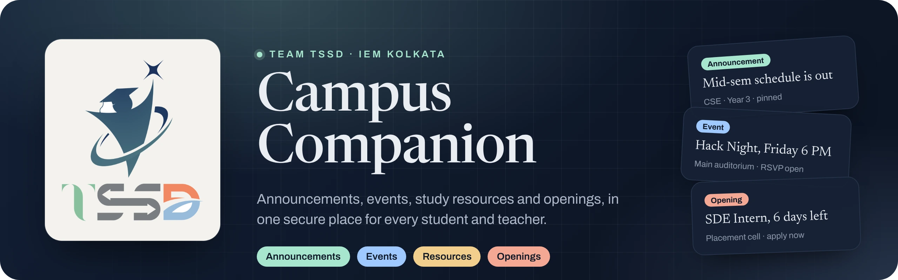
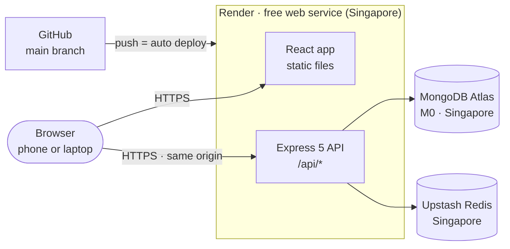
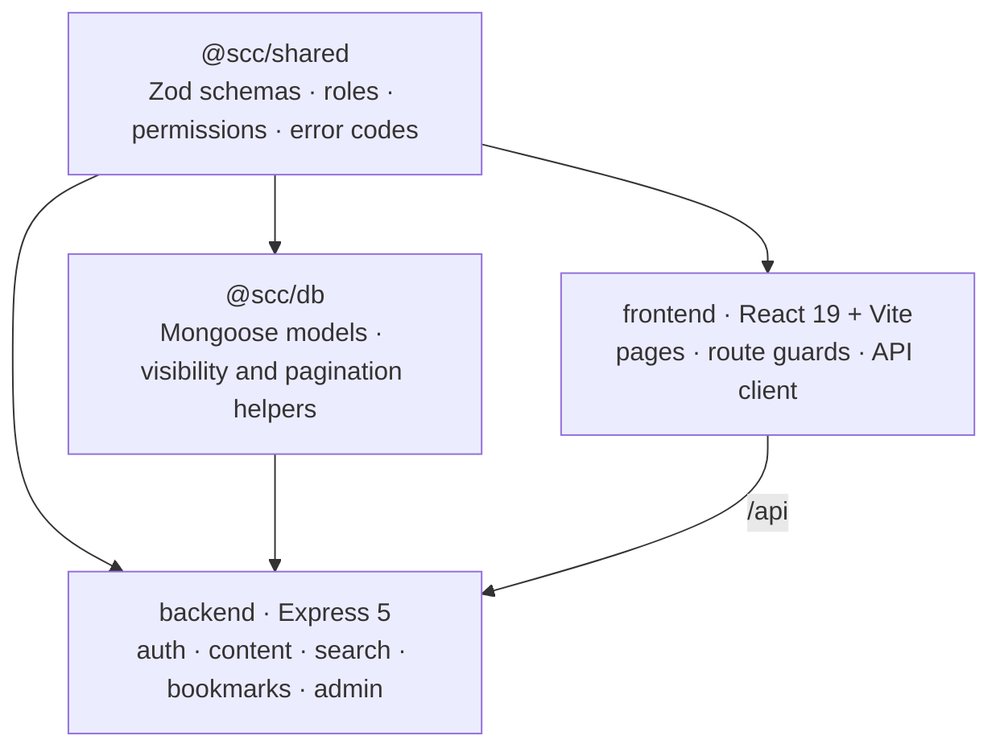

<div align="center">

<a href="https://campus-buddy-z3vs.onrender.com"></a>

# Campus Companion

**Announcements, events, study resources and openings, in one secure place for every student and teacher.**

[](https://campus-buddy-z3vs.onrender.com)
[](https://github.com/DebanganMALI/Campus-Buddy/actions/workflows/ci.yml)
[](https://github.com/DebanganMALI/Campus-Buddy/actions/workflows/security.yml)
[](https://www.typescriptlang.org/)
[](#tech-stack)
[](LICENSE)

**[Open the live app →](https://campus-buddy-z3vs.onrender.com)**

</div>

---

## Contents

[What is it?](#what-is-it) · [Features](#features) · [How to use it](#how-to-use-it) · [Architecture](#architecture) · [Tech stack](#tech-stack) · [Project structure](#project-structure) · [Deployment](#deployment) · [Useful scripts](#useful-scripts) · [Security](#security) · [Team](#team) · [License](#license)

---

## What is it?

Every college runs on scattered information: a WhatsApp group for notices, a drive
folder for notes, a notice board for placements, and no single place that knows
**who should see what**. Campus Companion (our *Smart Campus Companion* project) is
that single place.

It gives a college one dashboard for **announcements, events, study resources and
job/internship openings**, with five roles (**student, faculty, moderator,
placement officer, admin**) that each see and do different things. A student sees
only what is meant for their department and year; staff publish and manage content;
an admin manages the people.

The rule that makes it trustworthy is simple: **every permission is checked on the
server, never just hidden in the UI.** A student who calls a faculty-only endpoint
gets `403`, and content outside their department and year returns `404`, so it never
even reveals that it exists.

It is a **MERN** app written in **TypeScript end to end**, built as an npm-workspaces
monorepo around one shared contract, and it is **live on the internet** on free
hosting.

---

## Features

### For everyone
- **Personal dashboard:** the latest announcements, upcoming events and open
  opportunities for *your* department and year, on one screen.
- **Four content types:** announcements, events, study resources and openings, with
  filters, detail pages and cursor pagination.
- **Search:** one search box across all four content types, returning only what you
  are allowed to see.
- **Bookmarks:** save any item and find it later on your Bookmarks page.
- **Profile:** view and edit your details; your phone number is stored encrypted.
- **Works on phones:** bottom tab bar on mobile, pill navigation on desktop,
  keyboard and screen-reader friendly.

### By role

| Role | What they can do |
|------|------------------|
| **Student** | Read everything targeted at their department and year, search, bookmark |
| **Faculty** | Everything a student can, plus create, edit and delete their own announcements and events |
| **Moderator** | Everything faculty can, plus edit or remove *anyone's* content |
| **Placement officer** | Create and manage events; post and manage openings with eligibility and deadlines (through the API; the web form is coming next) |
| **Admin** | Everything, plus the **Manage users** page: list users, suspend and re-activate accounts |

### Under the hood
- **Audience targeting:** each post targets departments and years (or everyone), and
  the server filters every query by it.
- **Careful sessions:** httpOnly cookies, session-bound CSRF tokens, automatic
  session-secret rotation and stolen-session detection, and "log out of all devices".
- **One contract, three consumers:** request and response shapes, roles, permissions
  and error codes live in `@scc/shared` as Zod schemas, so the API and the web app
  can never drift apart silently.

> **Coming next:** file uploads for resources, a web form for openings, event RSVPs, notifications, a
> moderation queue, MFA for staff and Google sign-in. They are designed in the
> contract and are the next milestones.

---

## How to use it

### 1. Open the app
**https://campus-buddy-z3vs.onrender.com**

> It runs on Render's free plan, which sleeps after 15 minutes of inactivity. The
> first visit after a quiet spell can take **up to a minute** to wake up; after that
> it is fast.

### 2. Log in with a demo account
The live site is filled with demo data. Every demo account uses the password
**`TssdDemo@2026!`**

| Role | Email | What to try |
|------|-------|-------------|
| Student (CSE, Year 3) | `demo.student@iem.edu.in` | Dashboard, search, bookmarks |
| Student (ECE, Year 2) | `demo.ece@iem.edu.in` | Sees *different* announcements and openings than the CSE student |
| Student (IT, Year 1) | `demo.it@iem.edu.in` | A first-year view |
| Faculty | `demo.faculty@iem.edu.in` | Create an announcement or event |
| Moderator | `demo.moderator@iem.edu.in` | Edit or remove any post |
| Placement officer | `demo.placement@iem.edu.in` | Create an event |
| Admin | `demo.admin@iem.edu.in` | Profile menu → **Manage users** |

You can also **create your own account** with any `@iem.edu.in` email address
(password of at least 12 characters).

### 3. A two-minute tour
1. Log in as **demo.student**. The dashboard shows pinned announcements, upcoming
   events and openings with "days left".
2. Open **Events**, then a single event, and **bookmark** it. It now appears under
   Profile menu → **Bookmarks**.
3. Use **search** (🔍) for `placement` or `hackathon`.
4. Log out and log in as **demo.ece**. Some posts have changed: audience targeting at
   work.
5. Log in as **demo.faculty** and publish an announcement for one department; check
   that only that department's students can see it.
6. Log in as **demo.admin**, open **Manage users** and suspend a user. That user is
   signed out everywhere and can no longer log in until re-activated.

---

## Architecture

The app is **one web service** that serves both the API (`/api/*`) and the built
React app from the **same origin**, so no cross-site cookies or CORS are needed.
Data lives in MongoDB Atlas and rate-limit counters in Redis.



Inside the code, everything the parts agree on lives in **`@scc/shared`**:



**Life of a request.** Every API request passes through: request id → security
headers → rate limit → origin check → dangerous-key filter → CSRF check → the route.
The route then authenticates the session cookie, checks the role's permission, and
applies an object-level rule (owner, audience, published state) before it touches
the database. Errors come back as one consistent JSON shape with a reference id,
never a stack trace.

---

## Tech stack

| Layer | Choice |
|-------|--------|
| **Frontend** | React 19 · Vite 7 · React Router 7 · TanStack Query |
| **Backend** | Node.js 22 · Express 5 |
| **Database** | MongoDB (Atlas) · Mongoose 9 |
| **Cache / rate limits** | Redis (Upstash) · ioredis · rate-limiter-flexible |
| **Auth** | Session cookies · CSRF · Argon2id (`@node-rs/argon2`) |
| **Validation** | Zod 4 (one shared contract) |
| **Security headers / logs** | Helmet · pino (with redaction) |
| **Language** | TypeScript (`strict`, ESM) |
| **Testing** | Vitest · Supertest · mongodb-memory-server |
| **Hosting** | Render (Docker) · MongoDB Atlas M0 · Upstash Redis, all free tiers |
| **CI** | GitHub Actions: typecheck, build, lint, `npm audit`, gitleaks |

---

## Project structure

```
Campus-Buddy/
├─ shared/                 # @scc/shared: the contract (Zod schemas, roles, permissions, error codes)
├─ packages/db/            # @scc/db: Mongoose models, field encryption, visibility & pagination helpers
├─ backend/                # @scc/backend: Express 5 API
│  ├─ src/
│  │  ├─ config/           #   validated environment + security settings
│  │  ├─ middleware/       #   auth, authorize, CSRF, origin guard, headers, errors
│  │  ├─ routes/           #   auth, announcements, events, resources, openings,
│  │  │                    #   search, bookmarks, profile, admin
│  │  ├─ lib/              #   sessions, crypto, visibility, DTO mappers, mailer
│  │  └─ scripts/          #   secret generator, demo-data seed
│  └─ test/                #   integration tests (permissions, sessions, accounts, SPA, seed)
├─ frontend/               # React 19 + Vite web app (pages, components, API client)
├─ docs/                   # deployment guide, team rules, role guides, brand assets
├─ Dockerfile              # one image: builds the web app and the API together
├─ render.yaml             # Render Blueprint (free web service)
└─ package.json            # npm workspaces root
```

---

## Deployment

The live app is hosted **entirely on free tiers**, with no custom domain:

| Piece | Service | Notes |
|-------|---------|-------|
| App (API + web) | **Render** web service, Docker, Singapore | Auto-deploys on every push to `main` |
| Database | **MongoDB Atlas** M0, Singapore | Demo data loaded with the seed script |
| Rate limiting | **Upstash Redis**, Singapore | TLS connection |

The `Dockerfile` builds the shared libraries, the API and the React app into one
small image that runs as a non-root user. `render.yaml` describes the service, and
every secret is entered in the Render dashboard, never committed.

**To host your own copy**, follow **[docs/DEPLOY.md](docs/DEPLOY.md)**. It covers
creating the Atlas and Upstash databases, generating secrets, the Render Blueprint,
loading demo data, and a smoke test, step by step.

---

## Useful scripts

Run from the repository root (Node.js 22+).

| Script | What it does |
|--------|--------------|
| `npm install` | Install all workspaces and build the shared libraries |
| `npm run build` | Build every workspace |
| `npm run typecheck` | Type-check every workspace (`tsc --noEmit`) |
| `npm run lint` | ESLint across the repo |
| `npm test` | Run the backend integration tests (in-memory MongoDB) |
| `npm run gen:secrets -w @scc/backend` | Print fresh random secrets for an environment file |
| `npm run db:seed:prod -w @scc/backend` | Load the demo accounts and content into the production database (refuses unless explicitly allowed) |

---

## Security

Security is a first-class requirement, targeting **OWASP ASVS Level 2**.

**Access control**
- **Authorize on the server, always:** authentication → permission → object-level
  rule, on every protected route. A hidden button is never the control.
- **No information leaks:** registration always answers the same way (no account
  enumeration), and out-of-scope items return `404`, not `403`.
- **Only college emails** (`@iem.edu.in`) can register.

**Sessions and passwords**
- Passwords hashed with **Argon2id** plus a server-side pepper; minimum 12 characters.
- **Account lockout** after repeated failed logins.
- Sessions live in **httpOnly, Secure, `__Host-`/`__Secure-` cookies**, never in
  JavaScript storage.
- The session secret **rotates automatically**; reusing an old secret after the grace
  window is treated as theft, revokes the session and is logged.
- **Log out of all devices**, and suspending a user revokes all their sessions at once.

**Request protection**
- **CSRF:** double-submit token, HMAC-signed and bound to the session.
- **Origin guard:** state-changing requests from any other website are rejected.
- **Input validation** with the shared Zod schemas; unknown fields are rejected, and
  keys like `$`, `.` and `__proto__` are blocked before any handler (NoSQL injection
  and prototype pollution).
- **Rate limiting** backed by Redis: a per-IP ceiling on the whole API, plus stricter
  limits on login and registration.
- **Security headers** via Helmet: a strict Content-Security-Policy (`'self'` only,
  no inline scripts), HSTS, no framing, no referrer.

**Data and operations**
- Sensitive fields (like phone numbers) are **encrypted at rest** with AES-256-GCM.
- An **append-only audit log** records security events (logins, suspensions, session
  theft).
- Logs **redact** secrets and personal data; errors never expose stack traces.
- **No secrets in the repo:** every key and connection string lives in the host's
  environment settings. CI runs **gitleaks** and **`npm audit`** on every push.
- The production container runs as a **non-root** user.

Found a security issue? Please email **debanganmali.ai@yahoo.com** instead of opening
a public issue.

---

## Team

**Team TSSD** · Software Engineering project at the **Institute of Engineering &
Management (IEM), Kolkata**.

| # | Member | Role | What they built |
|---|--------|------|-----------------|
| 1 | **Debangan Mali** | Team lead · Backend · DevOps | Overall architecture and the shared contract (`@scc/shared`); the entire backend API (authentication, sessions, CSRF, role-based access, content APIs, search, bookmarks, profile, admin); the content models, query helpers and demo-data seed in `@scc/db`; connecting the frontend to the real API and the TSSD branding in the app; tests, CI and security scans; Docker, Render, Atlas and Upstash deployment; and the project docs |
| 2 | **Sweta Mandal** | UI / UX | UI/UX design of the app |
| 3 | **Tanisha Nandi** | Frontend | The React app: project setup, API client, route guards and the login page, then the full set of pages and components (dashboard, announcements, events, resources, opportunities, search, bookmarks, profile, manage users) |
| 4 | **Sahana Ghosh** | Database (partial) | The first database models for authentication (users, sessions, auth tokens, audit logs) with the MongoDB connection and field-encryption helpers. The content models and the rest of `@scc/db` were built by Debangan Mali |

---

## License

[MIT](LICENSE) © 2026 Team TSSD (Debangan Mali, Sweta Mandal, Tanisha Nandi, Sahana Ghosh)
