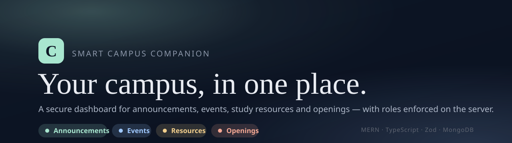
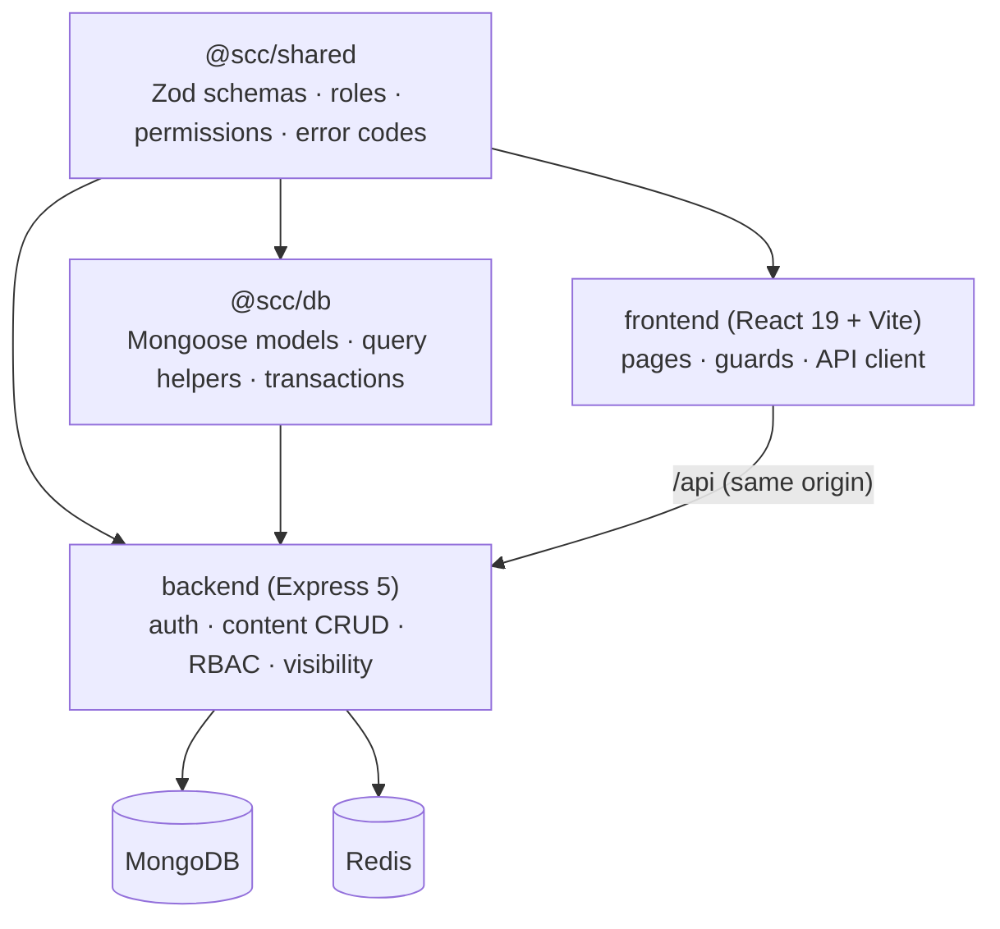

<div align="center">



# Smart Campus Companion

**One secure dashboard for campus announcements, events, study resources and openings.**

[](https://github.com/DebanganMALI/Campus-Buddy/actions/workflows/ci.yml)
[](https://www.typescriptlang.org/)
[](https://nodejs.org/)
[](#tech-stack)
[](LICENSE)

</div>

---

## What is it?

Every college runs on scattered information — a WhatsApp group for notices, a drive
folder for notes, a notice board for placements, and no single place that knows
**who should see what**. Smart Campus Companion is that single place.

It gives a college one dashboard for **announcements, events, study resources and
job/internship openings**, with five roles — **student, faculty, moderator,
placement officer, admin** — that each see and do different things. The rule that
makes it trustworthy is simple: **every permission is checked on the server, never
just hidden in the UI.** A student who calls a faculty-only endpoint gets a `403`;
content outside their department and year returns `404`, so it never even reveals
it exists.

It is a **MERN** app, **TypeScript end to end**, built as an npm-workspaces monorepo
around a single shared contract.

---

## Features

- **Role-based access control** — five roles, a permission matrix in one shared
  module, enforced on every write with owner-and-scope checks.
- **Audience-scoped visibility** — students see only content targeted to their
  department + year (or "all"); staff see everything published. Out-of-scope reads
  return `404`, not `403`.
- **Four content types** — announcements, events, resources and openings, each with
  create / read / update / delete, cursor pagination and soft deletes.
- **Session auth done carefully** — httpOnly session cookies (no tokens in
  `localStorage`), double-submit **CSRF** protection, **Argon2id** password hashing
  with a server-side pepper, and an origin guard against cross-site writes.
- **One contract, three consumers** — request/response shapes, roles, permissions
  and error codes live in `@scc/shared` as Zod schemas; the backend validates with
  them and the frontend types itself from them, so the two can never drift silently.
- **Hardening baked in** — Helmet CSP, NoSQL-operator / prototype-pollution
  rejection, a Redis-backed rate limiter, a redacting logger, and a central error
  handler that never leaks stack traces.

> **Status:** auth, the content API and the React client are working end to end
> against MongoDB. MFA, Google SSO, file uploads, search, bookmarks, admin and
> notifications are designed and scoped — see the [Roadmap](#roadmap).

---

## Tech stack

| Layer | Choice |
|-------|--------|
| Frontend | React 19 · Vite 7 · React Router 7 · TanStack Query |
| Backend | Node 22 · Express 5 |
| Database | MongoDB · Mongoose 9 |
| Cache / limits | Redis (ioredis) |
| Auth | Session cookies · CSRF · Argon2id (`@node-rs/argon2`) |
| Validation | Zod 4 (one shared contract) |
| Language | TypeScript (`strict`, ESM) |
| Tooling | npm workspaces · ESLint · Vitest |

---

## Architecture

Everything the three apps agree on lives in **`@scc/shared`** — one source of truth
for the API contract. The backend validates against it; the frontend types itself
from it; the database aligns its models to it.



**Request path.** The SPA calls `/api` on the same origin (Vite proxies it in
development). The API runs every request through request-id → security headers →
origin guard → CSRF check → the route, where it authenticates the session cookie,
checks the permission, then applies an object-level ownership/visibility policy
before touching the database.

### Project structure

```
Campus-Buddy/
├─ shared/              # @scc/shared — the contract (Zod schemas, roles, permissions, errors)
├─ packages/db/         # @scc/db — Mongoose models, audience/visibility/pagination helpers
├─ backend/             # @scc/backend — Express 5 API
│  ├─ src/
│  │  ├─ config/        #   validated env + security settings
│  │  ├─ middleware/    #   auth, authorize, csrf, security headers, error handler
│  │  ├─ routes/        #   auth + content CRUD
│  │  └─ lib/           #   crypto, sessions, DTO mappers
│  └─ docker-compose.yml #  local MongoDB (replica set), Redis, Mailpit
├─ frontend/            # @scc/frontend — React 19 + Vite SPA
├─ docs/                # architecture & role docs
└─ package.json         # npm workspaces root
```

---

## Getting started

### Prerequisites

- **Node.js 22+**
- A **MongoDB** — either **Docker Desktop** (the repo ships a compose file with a
  single-node replica set) or a **MongoDB Atlas** connection string.

### Setup

```bash
git clone https://github.com/DebanganMALI/Campus-Buddy.git
cd Campus-Buddy
npm install                 # installs workspaces and builds the shared libraries
```

Create `backend/.env` from the example and fill in secrets:

```bash
cp backend/.env.example backend/.env
npm run gen:secrets -w @scc/backend   # prints CSRF/pepper/MFA/JWT values to paste in
```

### Run the stack

```bash
npm run infra:up           # start MongoDB (rs0), Redis and Mailpit via Docker
npm run dev                # start the API on http://localhost:4000
```

Then, in a second terminal, start the frontend against the real API:

```bash
cd frontend
npm install
npm run dev:api            # http://localhost:5173, proxying /api to the backend
```

Open **http://localhost:5173**, register a student (password ≥ 12 characters), and
log in.

> Prefer mocks? `npm run dev` inside `frontend/` runs the whole UI against an
> in-browser mock API — no backend or database required.

### Useful scripts (root)

| Script | Does |
|--------|------|
| `npm run dev` | Run the API in watch mode |
| `npm run build` | Build every workspace |
| `npm run typecheck` | `tsc --noEmit` across workspaces |
| `npm run lint` | ESLint |
| `npm run infra:up` / `infra:down` | Start / stop the local Docker services |

---

## Security

Security is a first-class requirement, targeting **OWASP ASVS Level 2**:

- **Authorize on the server, always.** Authentication → permission → object-level
  policy, on every protected route. A hidden button is never the control.
- **No enumeration.** Registration always returns the same `202`; out-of-scope
  objects return `404`, not `403`.
- **Safe sessions.** Tokens live in httpOnly cookies, never in JavaScript storage;
  CSRF is a double-submit token bound to the session; a foreign `Origin` on an
  unsafe request is rejected.
- **Strong hashing.** Argon2id with a server-side pepper; secrets never committed.
- **Input is validated** with the shared Zod schemas, and unknown fields are
  rejected. Dangerous keys (`$`, `.`, `__proto__`) are stripped before any handler.

---

## Roadmap

**Working today**

- [x] Merged monorepo, CI, shared contract
- [x] Database models + query helpers (`@scc/db`)
- [x] Session auth (register · login · logout · me) with CSRF + Argon2id
- [x] Content CRUD for announcements, events, resources, openings — with RBAC and visibility
- [x] React client wired to the real API

**Planned**

- [ ] Profile, search, bookmarks and admin routes
- [ ] Resource uploads (presigned storage + virus scan) and event RSVP
- [ ] MFA, Google SSO, email verification, account lockout
- [ ] Background worker (scheduling, expiry, notifications)
- [ ] Deployment (same-origin hosting, HTTPS) and load testing

---

## Team

A Software Engineering project at **IEM Kolkata**.

| Member | Area |
|--------|------|
| Debangan Mali | Backend · integration · coordination |
| Sahana Ghosh | Database |
| Tanisha Nandi | Frontend |
| Sweta Mandal | UI / UX |

---

## License

[MIT](LICENSE) © Debangan Mali

**Contact:** debanganmali.ai@yahoo.com
