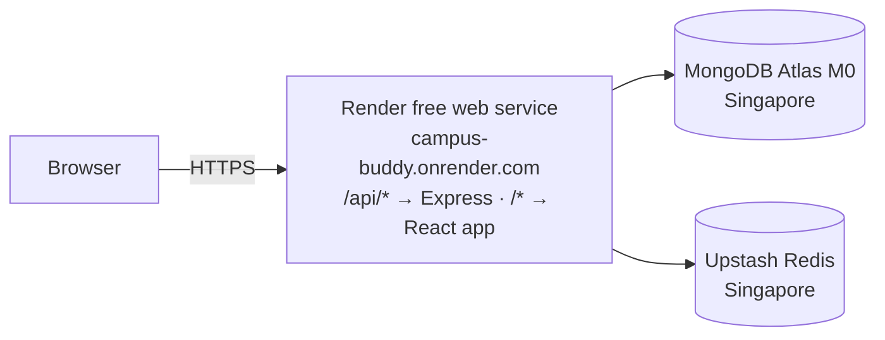

# Deploying Campus Buddy — free, no domain, no card

One free Render web service serves **both the web app and the API from the same
origin** (required by the cookie/CSRF design, see [AGENTS.md §6](AGENTS.md)).
Data lives in two free external services.



**Cost: ₹0.** Don't add a payment card to Render or Upstash. Without one, running past
a free limit **suspends** the service until the next month instead of billing you
(and on Upstash, adding a card moves your database to pay-as-you-go).

### Free-tier facts that shape this setup

| Service | What you get | What it means here |
|---|---|---|
| **Render** web service | 750 instance-hours/month; sleeps after 15 min idle; ~1 min cold start | Open the URL a minute before a demo |
| | No shell / one-off jobs | The database is seeded **from your PC** (step 7) |
| | Outbound ports 25, 465, 587 blocked | No SMTP: email stays disabled until Tier 2 uses an HTTPS email API |
| | No persistent disk | Fine: all state is in Atlas + Upstash |
| **MongoDB Atlas** M0 | 512 MB, replica set | Transactions work; plenty for the demo |
| **Upstash Redis** | 500K commands/month, 256 MB, 1 database | Rate limiting uses it; demo traffic is far below the cap |

Sources: [Render free tier](https://render.com/docs/free) · [Upstash pricing](https://upstash.com/pricing/redis)

---

## 0. Pre-flight: run the production image locally (recommended)

Proves the image builds and serves the app before anything goes online. Needs
Docker Desktop running and your local stack (`npm run infra:up`, `npm run db:seed`).

```powershell
cd "F:\Campus buddy"
docker build -t campus-buddy .
docker run --rm -p 4000:4000 --env-file backend/.env `
  -e NODE_ENV=development `
  -e APP_ORIGIN=http://localhost:4000 `
  -e CLIENT_DIR=/app/client `
  -e MONGO_URI="mongodb://host.docker.internal:27017/scc?directConnection=true" `
  -e REDIS_URL=redis://host.docker.internal:6379 `
  campus-buddy
```

Open <http://localhost:4000> and sign in as `demo.student@iem.edu.in` /
`CampusDemo@2026`. Stop it with `Ctrl+C`.

---

## 1. Put the tested code on `main`

Render deploys the `main` branch (see `render.yaml`).

```powershell
cd "F:\Campus buddy"
git push -u origin feature/security-hardening
```

Open a pull request `feature/security-hardening → main` on GitHub, wait for CI to
pass, and merge it.

## 2. Generate production secrets (once)

```powershell
npm run gen:secrets -w @scc/backend
```

Save the printed lines in your password manager. The **same values** go into Render
(step 5) and into `backend/.env.production` (step 7). `PASSWORD_PEPPER` in particular
must match in both places, or the demo accounts can't sign in.

## 3. MongoDB Atlas (database)

1. Sign up at [mongodb.com/cloud/atlas](https://www.mongodb.com/cloud/atlas) and create a **Free (M0)** cluster: provider **AWS**, region **Singapore (ap-southeast-1)**.
2. **Database Access** → add a user, e.g. `scc_app`, with an **autogenerated password** (copy it).
3. **Network Access** → **Add IP Address** → **Allow access from anywhere** (`0.0.0.0/0`).
   *Why:* Render's free tier has no fixed outbound IP. Access is still protected by the
   database password and TLS.
4. **Connect → Drivers** → copy the `mongodb+srv://…` string. Put your password in,
   and add the database name `scc` before the `?`:

   ```
   mongodb+srv://scc_app:<password>@<cluster>.mongodb.net/scc?retryWrites=true&w=majority
   ```

## 4. Upstash Redis (rate limiting)

1. Sign up at [upstash.com](https://upstash.com) (no card).
2. **Create Database** → Redis → region **AWS ap-southeast-1 (Singapore)**, free plan, TLS on.
3. Copy the Node/ioredis connection string. It starts with **`rediss://`** (two *s* = TLS):

   ```
   rediss://default:<password>@<name>.upstash.io:6379
   ```

## 5. Render (the app)

1. Sign up at [render.com](https://render.com) with GitHub (no card).
2. **New → Blueprint** → pick the `Campus-Buddy` repo. Render reads `render.yaml` and
   shows one free web service, `campus-buddy`.
3. Fill in the values it asks for:

   | Key | Value |
   |---|---|
   | `APP_ORIGIN` | `https://campus-buddy.onrender.com` (fix in step 6 if Render picks another URL) |
   | `MONGO_URI` | from step 3 |
   | `REDIS_URL` | from step 4 |
   | `CSRF_SECRET`, `PASSWORD_PEPPER`, `MFA_ENCRYPTION_KEY`, `FIELD_ENCRYPTION_KEY`, `JWT_PRIVATE_KEY`, `JWT_KEY_ID` | from step 2 |

4. **Apply**. The first build takes ~5–10 minutes. In **Logs**, you want to see
   `Database connected successfully` and `API listening`.

## 6. Make `APP_ORIGIN` match the real URL

Copy the URL shown at the top of the service page. If it isn't exactly
`https://campus-buddy.onrender.com` (the name may be taken), set `APP_ORIGIN` to the
real URL under **Environment → Save** (Render redeploys).

*Why it matters:* the server rejects state-changing requests from any other origin,
so a mismatch makes **login fail with 403**.

## 7. Seed the live database (from your PC)

Create `backend/.env.production`. It's git-ignored by the `.env.*` rule, and it holds
production secrets, so keep it private.

```dotenv
NODE_ENV=production
APP_ORIGIN=https://campus-buddy.onrender.com
TRUST_PROXY=3
ALLOWED_EMAIL_DOMAINS=iem.edu.in
MONGO_URI=<same as Render>
REDIS_URL=<same as Render>
CSRF_SECRET=<same as Render>
PASSWORD_PEPPER=<same as Render>
MFA_ENCRYPTION_KEY=<same as Render>
FIELD_ENCRYPTION_KEY=<same as Render>
JWT_PRIVATE_KEY=<same as Render>
JWT_KEY_ID=<same as Render>
SEED_ALLOW=true
SEED_PASSWORD=<choose 12+ characters: the shared demo password>
```

```powershell
npm run db:seed:prod -w @scc/backend
```

It creates the indexes, the 7 demo accounts and the sample content, and prints the
account list. It's safe to re-run: existing users and non-empty collections are left alone.

## 8. Verify the client IP (`TRUST_PROXY`)

Per-IP rate limits and the login lockout need Express to see each visitor's **real**
IP behind Render's proxies. `render.yaml` starts at `3`. Check it once:

1. **Environment** → set `LOG_LEVEL=debug` → Save. Request log lines now include `clientIp`.
2. **Too low?** On your phone (mobile data), open the site and look up your IP on any
   "what is my IP" page. In **Logs**, your request's `clientIp` must equal it. If it shows
   some other address, **increase** `TRUST_PROXY` by 1 and retry.
3. **Too high?** From your PC, send a fake header:

   ```powershell
   curl.exe -H "X-Forwarded-For: 1.2.3.4" https://campus-buddy.onrender.com/api/health
   ```

   If `clientIp` shows `1.2.3.4`, the IP can be spoofed: **decrease** `TRUST_PROXY` by 1 and retry.
4. Set `LOG_LEVEL=info` again when both checks pass.

## 9. Smoke test (from the §12.1 demo checklist)

- [ ] The site loads over HTTPS (allow ~1 min if it was asleep).
- [ ] `demo.student` sees CSE / Year-3 content; `demo.ece` sees different content.
- [ ] One keyword in search (e.g. `intern`, `exam`) returns results.
- [ ] `demo.student` has two bookmarks.
- [ ] `demo.faculty` can publish an announcement; `demo.student` then sees it.
- [ ] A student can't use staff features (the API answers 403).
- [ ] `demo.admin` suspends a user, and that user is signed out immediately.
- [ ] [securityheaders.com](https://securityheaders.com) scan of the URL.

Not live yet (Tier 2): email verification and password reset, resource file
upload/download, MFA, Google sign-in.

---

## Updating

Merge to `main` and Render rebuilds and redeploys automatically.

## Troubleshooting

| Symptom | Likely cause → fix |
|---|---|
| Login fails with **403** | `APP_ORIGIN` ≠ the real URL → step 6 |
| Logs show `Invalid environment configuration` | A value is missing or malformed; the message names it |
| Demo accounts get **invalid credentials** | `PASSWORD_PEPPER` (or `SEED_PASSWORD`) differs between Render and `.env.production` |
| Mongo timeout / `querySrv` error | Atlas Network Access isn't `0.0.0.0/0`, or the URI is wrong |
| Everyone gets rate-limited together | `TRUST_PROXY` too low → step 8 |
| First request hangs ~1 min | Free-tier cold start; expected |

## Fallback: no Docker (Render native Node runtime)

If Docker isn't offered for your free service, create the web service manually instead
of using the Blueprint: **New → Web Service** → this repo → Language **Node**, branch `main`.

- **Build command:**
  `npm ci --ignore-scripts && npm run build:libs && npm run build -w @scc/backend && npm ci --ignore-scripts --prefix frontend && npm run build --prefix frontend`
- **Start command:** `node backend/dist/server.js`
- **Health check path:** `/api/health`
- **Environment:** everything from `render.yaml` and step 5, plus
  `NODE_VERSION=22` and `CLIENT_DIR=/opt/render/project/src/frontend/dist`
